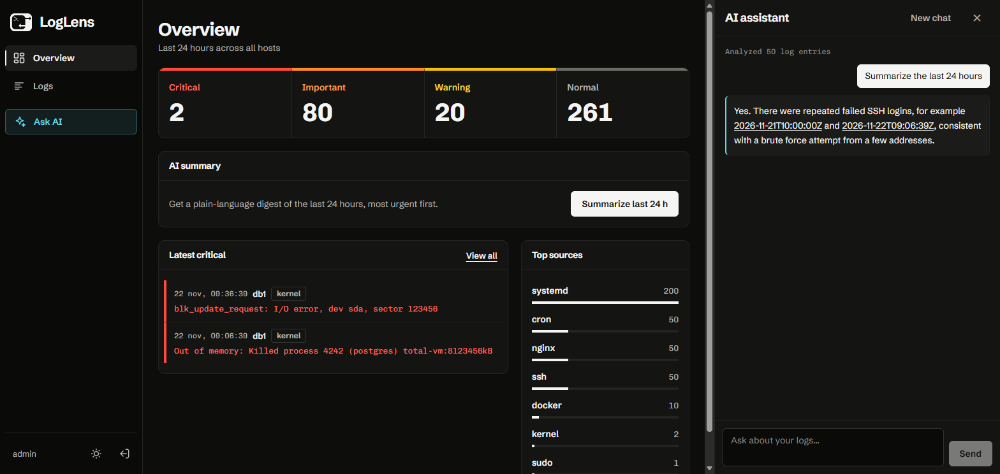
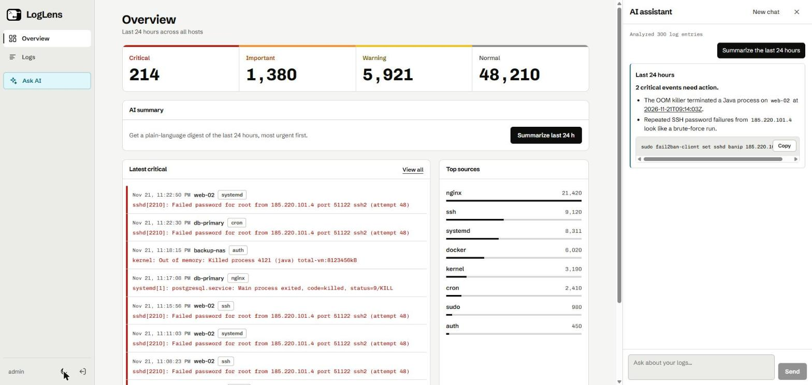
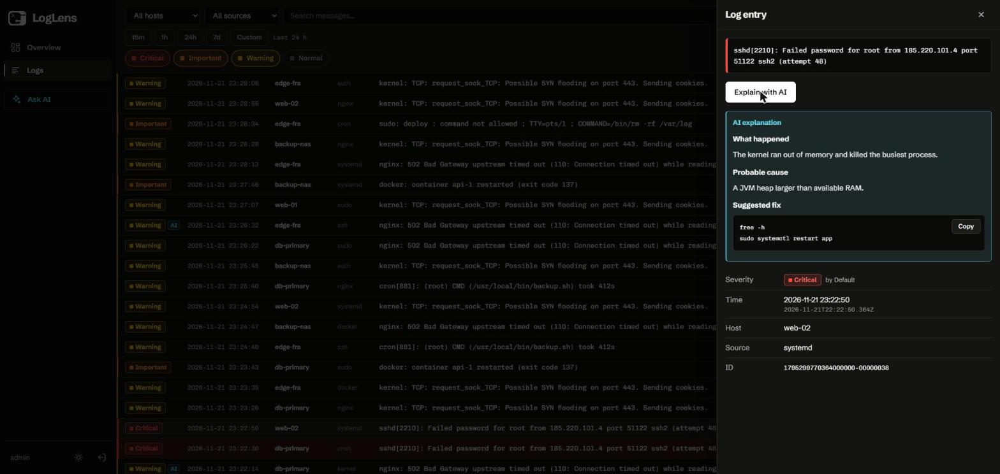
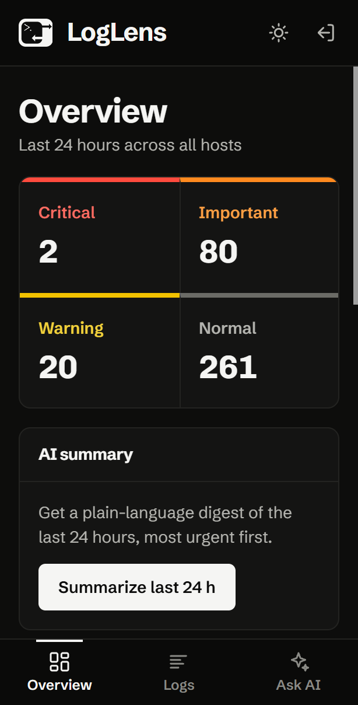
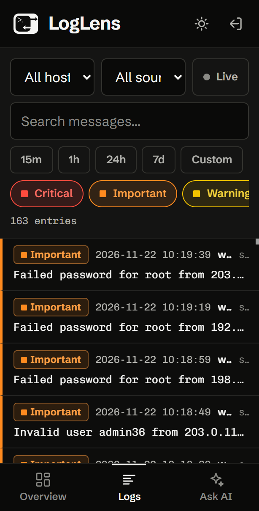

# LogLens

LogLens is a self-hosted log viewer for PC and mobile. It collects server logs, ranks every event by
severity (critical, important, warning, normal) so what matters shows first, and adds an AI assistant
that explains a log line in plain language or answers questions such as "were there SSH brute force
attempts today?" citing real timestamps. Critical events can be pushed to your phone.

The AI never hides logs: it only labels and orders them. Rule-based severity always wins over AI severity.

| Overview with the AI assistant (dark) | Overview (light) |
|---|---|
|  |  |
| **Logs and an AI explanation** | **Mobile** |
|  |   |

Screenshots use demo data; the AI answers come from a test model.

## Architecture

```
[Monitored server]                          [LogLens server: docker compose]
  journald, docker, nginx/apache/auth.log
        |                                     web (nginx :8080) --/loki/api/v1/push--> Loki (internal)
  Vector (agent/) --push + bearer token-------> |   \--/api/--> api (Rust, axum)        ^ query / tail
  labels: host, source, severity, container     |                 |  \--> AI provider (Ollama / OpenAI-compatible)
                                              React PWA           \--> ntfy (:8090) --> phone app
```

- **agent/**: Vector pipeline. `normalize.vrl` sets host, source and container; `severity.vrl` maps the journald
  priority and applies regex rules (`kernel panic`, `Failed password`, HTTP 5xx, ...).
- **loki/**: Grafana Loki in single binary mode, filesystem storage, 30-day retention.
- **backend/**: Rust workspace (one crate per feature). The `api` binary serves `/api/*`.
- **frontend/**: TypeScript + React PWA, served by nginx, which proxies `/api/` to the backend.
- **ntfy**: receives an alert for every new critical event (deduplicated for 10 minutes).

Loki labels stay low-cardinality: `host`, `source` (ssh, kernel, systemd, cron, sudo, auth, docker, podman,
nginx, apache, other), `severity`, and `container` for docker/podman only. Messages, PIDs and IPs are never labels.

## Quick start

Requirements: Docker with the Compose plugin.

**From a release** (no build needed): download `loglens-deploy-<version>.tar.gz` and `SHA256SUMS` from the
GitHub release, check them with `sha256sum -c SHA256SUMS`, unpack, then run `bash init-env.sh && docker compose pull
&& docker compose up -d`. Images come from `ghcr.io/bagpotato/loglens-api` and `loglens-web`. The steps below build
from the repository instead. Releases are cut by pushing a `v*` tag (`.github/workflows/release.yml`).

```sh
bash init-env.sh        # creates .env with random admin password, JWT secret, push token and ntfy topic
docker compose up -d
```

`init-env.sh` prints the generated admin password and push token. Open `http://<server>:8080` and sign in with
`LOGLENS_ADMIN_USER` / `LOGLENS_ADMIN_PASSWORD`. The admin account is created on the first start only; changing the
password in `.env` later has no effect. Placeholder or weak secrets are rejected at startup.

Check Loki (from the server itself): `curl http://127.0.0.1:3100/ready` should print `ready`.

## Install the agent on a server

On each Debian/Ubuntu or Fedora server you want to monitor (also on the LogLens server itself):

```sh
git clone <this repository> loglens && cd loglens
sudo bash agent/install-agent.sh http://<loglens-server>:8080 <LOGLENS_PUSH_TOKEN>
```

Agents push to the web port; nginx forwards `/loki/api/v1/push` to Loki only when the request carries
`Authorization: Bearer <LOGLENS_PUSH_TOKEN>`. Loki itself is not reachable from the network.

The installer adds the official Vector package repository, installs Vector, copies `agent/vector/` to
`/etc/vector/loglens`, stores the URL and token in `/etc/vector/loglens.env` (mode 600), adds a systemd drop-in that runs
`vector --config-dir /etc/vector/loglens`, gives the `vector` user access to the journal, `adm` and Docker logs,
validates the config and restarts the service. Running it again is safe (it updates the config).

## Tailscale

LogLens can live only inside your tailnet, with real HTTPS (needed to install the PWA on a phone):

1. In the Tailscale admin console enable MagicDNS and HTTPS certificates, and create an auth key.
2. In `.env`: `TS_AUTHKEY=tskey-...`, optionally `TS_HOSTNAME=loglens`. To hide the plain ports from your LAN,
   also set `LOGLENS_WEB_BIND=127.0.0.1` and `LOGLENS_NTFY_BIND=127.0.0.1`.
3. `docker compose --profile tailscale up -d`

Then, from any device in the tailnet:

- Web UI / PWA: `https://loglens.<tailnet>.ts.net`
- Agents: `sudo bash agent/install-agent.sh https://loglens.<tailnet>.ts.net <LOGLENS_PUSH_TOKEN>`
  (the monitored server needs Tailscale too; the push token is still required)
- Android app: use `https://loglens.<tailnet>.ts.net` as the server URL
- ntfy phone app: server `https://loglens.<tailnet>.ts.net:8443`

The sidecar runs in userspace mode (no `/dev/net/tun` or extra privileges) and never enables Funnel, so nothing
is exposed to the internet. Its state lives in the `tailscale-state` volume, so the auth key is used once.

## Android app (Rust, Tauri 2)

`mobile/` packages the same frontend as a native Android app. Build it with the Android SDK + NDK, JDK 17+ and
the Rust Android targets (`rustup target add aarch64-linux-android x86_64-linux-android`):

```sh
cd mobile && npm install && npm run android:release   # or android:build for an x86_64 emulator debug APK
```

Enter your server URL on the login screen (e.g. `http://192.168.1.10:8080`). On Android 17+ allow the
"nearby devices / local network" prompt so the app can reach LAN servers. The API allows the app's origin through
`LOGLENS_CORS_ORIGINS` (default covers Tauri). See `mobile/MODULE.md` for the Windows build workaround.

## Demo logs

```sh
bash demo/generate-logs.sh          # one batch
bash demo/generate-logs.sh --loop   # a new batch every 10 s (--interval N to change)
```

It writes through `logger`: SSH brute force from several IPs, an OOM kill, disk I/O errors and a read-only
remount, nginx 2xx/4xx/5xx access lines, cron, sudo, systemd start/stop and normal application noise.
Run it on a host with the agent installed, then filter by `critical` and `important` in the UI.

## Phone alerts (ntfy)

1. Install the ntfy app (Android: Google Play / F-Droid; iOS: App Store).
2. In the app, add a subscription: server `http://<loglens-server>:8090`, topic = `LOGLENS_NTFY_TOPIC`.
3. Every new critical event sends one notification (the same message template at most once per 10 minutes).

For instant notifications on iOS set `LOGLENS_NTFY_BASE_URL=http://<server>:8090` and
`LOGLENS_NTFY_UPSTREAM_BASE_URL=https://ntfy.sh` (only a message ID is forwarded to ntfy.sh, never the content).
Leave `LOGLENS_NTFY_URL` empty to disable alerts.

## AI provider

**Ollama on the Docker host** (default): install Ollama, run `ollama pull llama3.1:8b`, and keep
`LOGLENS_AI_URL=http://host.docker.internal:11434`. Make Ollama listen on the Docker bridge
(`OLLAMA_HOST=0.0.0.0`) if the API cannot reach it.

**Ollama in Compose**: `docker compose --profile ollama up -d`, set `LOGLENS_AI_URL=http://ollama:11434`, then
`docker compose exec ollama ollama pull llama3.1:8b`. (CPU only unless you add a GPU reservation.)

**OpenAI-compatible API** (OpenAI, vLLM, LM Studio, OpenRouter, ...):

```sh
LOGLENS_AI_PROVIDER=openai
LOGLENS_AI_URL=https://api.openai.com
LOGLENS_AI_MODEL=gpt-4o-mini
LOGLENS_AI_KEY=<your key>
```

With `LOGLENS_AI_MASK=true` (default) IP addresses and usernames are replaced by placeholders before any log
text is sent to the provider, and restored in the answer.

After editing `.env`, apply it with `docker compose up -d`.

## Development

```sh
# Backend (Rust stable)
cd backend
cargo test
cargo clippy --all-targets -- -D warnings
LOGLENS_JWT_SECRET=$(openssl rand -hex 32) LOGLENS_ADMIN_PASSWORD=local-dev-only-123 LOGLENS_DB_URL=sqlite://loglens.db cargo run -p loglens-api

# Frontend (Node 24)
cd frontend
npm ci
npm run dev        # Vite dev server
npm test           # Vitest

# Loki only, for local backend work
docker compose up -d loki

# Vector pipeline unit tests (needs Vector installed)
cd agent/vector
LOGLENS_LOKI_URL=http://localhost:8080 LOGLENS_PUSH_TOKEN=test-token-0123456789abcdef vector test --dangerously-allow-env-var-interpolation --config-dir .
```

Each backend crate and frontend feature has a `MODULE.md` describing its purpose, public API and env vars.

## Environment variables

| Variable | Read by | Default / example | Purpose |
|---|---|---|---|
| `LOGLENS_BIND` | api | `0.0.0.0:8080` | API listen address (pinned in Compose) |
| `LOGLENS_LOKI_URL` | api, agent | `http://loki:3100` | Loki base URL (agent: the LogLens web URL) |
| `LOGLENS_DB_URL` | storage | `sqlite:///data/loglens.db` | SQLite database (pinned in Compose) |
| `LOGLENS_ADMIN_USER` | auth | `admin` | Admin created on first start |
| `LOGLENS_ADMIN_PASSWORD` | auth | generated by `init-env.sh` | Its password (first start only, min 10 chars) |
| `LOGLENS_JWT_SECRET` | auth | generated by `init-env.sh` | JWT signing key, min 32 random chars, required |
| `LOGLENS_PUSH_TOKEN` | web (nginx), agent | generated by `init-env.sh` | Bearer token for agent log pushes |
| `LOGLENS_CORS_ORIGINS` | api | Tauri origins | Origins allowed to call the API (mobile app) |
| `LOGLENS_AI_PROVIDER` | ai | `ollama` | `ollama` or `openai` |
| `LOGLENS_AI_URL` | ai | `http://host.docker.internal:11434` | Provider base URL |
| `LOGLENS_AI_MODEL` | ai | `llama3.1:8b` | Model name |
| `LOGLENS_AI_KEY` | ai | empty | API key (OpenAI-compatible) |
| `LOGLENS_AI_MASK` | ai | `true` | Mask IPs and usernames sent to the AI |
| `LOGLENS_NTFY_URL` | alerts | `http://ntfy:80` | ntfy server; empty disables alerts |
| `LOGLENS_NTFY_TOPIC` | alerts | `loglens-alerts` | ntfy topic |
| `LOGLENS_WEB_PORT` | compose | `8080` | Host port of the web UI |
| `LOGLENS_WEB_BIND`, `LOGLENS_NTFY_BIND` | compose | `0.0.0.0` | Host address for the web/ntfy ports (`127.0.0.1` with Tailscale) |
| `TS_AUTHKEY`, `TS_HOSTNAME`, `TS_EXTRA_ARGS` | compose (tailscale) | empty, `loglens`, empty | Tailscale sidecar (profile `tailscale`) |
| `LOGLENS_LOKI_PORT` | compose | `3100` | Loki port, bound to 127.0.0.1 (debugging only) |
| `LOGLENS_NTFY_PORT` | compose | `8090` | Host port of ntfy (phone subscription) |
| `LOGLENS_NTFY_BASE_URL` | compose (ntfy) | empty | Public ntfy URL |
| `LOGLENS_NTFY_UPSTREAM_BASE_URL` | compose (ntfy) | empty | `https://ntfy.sh` for iOS push |

## Security notes

- **Secrets**: `init-env.sh` generates the admin password, JWT secret and push token; startup refuses
  placeholders. Anyone who knows the JWT secret can forge logins, so keep `.env` private.
- **Loki has no authentication of its own** (`auth_enabled: false`), so it is bound to `127.0.0.1` only.
  Agents push through nginx, which requires the push token; reads go through the authenticated API.
- **AI answers** never render images and the web UI sends a strict Content-Security-Policy, so text injected
  into logs cannot make the browser leak data to other hosts.
- **ntfy** topics are not protected by default: use an unguessable `LOGLENS_NTFY_TOPIC`, or configure ntfy access
  control, and do not expose port 8090 publicly unless you need to.
- **TLS**: the web UI is plain HTTP on port 8080. Put it behind a reverse proxy with HTTPS (Caddy, Traefik,
  nginx) before using it over the internet; the PWA install also requires HTTPS outside localhost.
- **AI**: with an external provider, log text leaves your network. Keep `LOGLENS_AI_MASK=true` or use Ollama.
- `.env` holds secrets: it is git-ignored, keep it that way.
